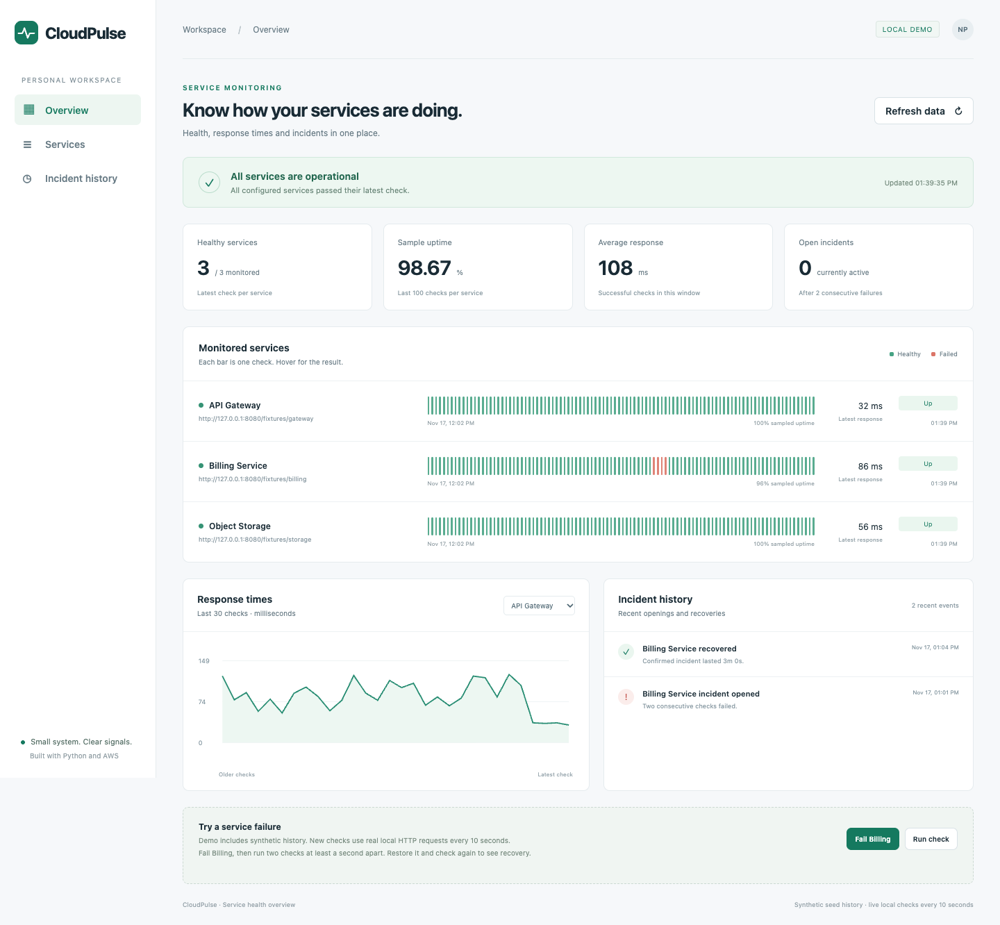
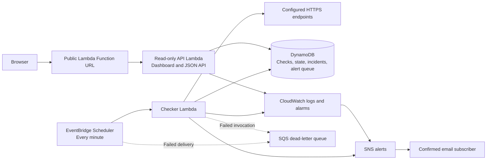

# CloudPulse

[](https://github.com/Nihal0801/cloudpulse/actions/workflows/ci.yml)

CloudPulse checks websites and APIs, records response times, and tracks when a service goes down and comes back up. It runs locally without an AWS account, and includes Terraform configuration for AWS.

## Why I built it

I wanted to build a cloud project where I could understand the full flow: checking a service, saving the result, detecting a problem, and sending an alert. I also wanted to learn how retries, IAM permissions, monitoring, and cleanup fit into a small application.

The local demo is working and tested. The AWS configuration has passed Terraform validation and mocked infrastructure tests. It has **not been deployed or tested in a live AWS account** yet.

## What it does

- Monitors up to 10 configured public HTTPS endpoints.
- Records HTTP status, response time, failures, and recent monitoring history.
- Marks the first failure as degraded. Two consecutive failures open an incident.
- Resolves the incident after one successful check.
- Sends an alert when an incident opens or resolves, rather than on every failed check.
- Saves pending alerts and retries them if notification delivery fails.
- Shows stale data when no new checks arrive for more than three minutes.

A successful check means an HTTP response between 200 and 299. Redirects count as failures, so use the final URL for your health endpoint. Response time measures DNS, connection, TLS, and response headers; it does not include downloading the full response body.

## Dashboard

These are actual screenshots of the running local application. The demo starts with clearly labelled synthetic history, then adds real HTTP checks against local fixture services.



[View an active incident](docs/dashboard-incident.png) · [View the mobile layout](docs/dashboard-mobile.png)

## Technologies

Python, SQLite, HTML, CSS, JavaScript, AWS Lambda, DynamoDB, EventBridge Scheduler, SNS, SQS, CloudWatch, Terraform, and GitHub Actions.

There is no frontend framework or build step. The local demo uses Python's standard library. AWS Lambda provides the Boto3 SDK used by the cloud backend.

## Cloud architecture



The API and checker have separate IAM roles. The API can read the monitoring table. The checker can write checks, publish to one SNS topic, and send failed invocations to one SQS queue. Scheduler can invoke only the checker and send to that queue.

Each service uses one DynamoDB partition. State, checks, incidents, and pending alerts have different sort-key prefixes. A transaction saves a check and its state together. Conditional writes reject duplicate or older checks. The checker runs with concurrency limited to one to avoid competing incident updates.

## Run the local demo

Use Python 3.9 or newer. Python 3.12 is recommended, especially for AWS development.

```bash
git clone https://github.com/Nihal0801/cloudpulse.git
cd cloudpulse
python3 -m cloudpulse.local
```

Open **http://127.0.0.1:8080**. No installation or AWS credentials are needed for the demo.

The demo includes three local fixture services and 100 seeded checks per service. New checks run every 10 seconds. Alerts are printed in the terminal.

To try an incident:

1. Click **Fail Billing**.
2. Click **Run check** twice, at least a second apart, or wait for two scheduled checks.
3. Billing changes to down, and an incident appears.
4. Click **Restore Billing**, then run another check to see the recovery.

Stop the application with `Ctrl+C`. The SQLite database is stored in `.data/cloudpulse.db`. Delete that file while the app is stopped to reset the demo.

For a different port:

```bash
python3 -m cloudpulse.local --port 8090
```

### Monitor real endpoints locally

Copy `targets.example.json` to a new JSON file and replace the example with endpoints you own or have permission to check. Use a separate database from the fixture demo.

```bash
python3 -m cloudpulse.local --targets targets.example.json --db .data/real.db
```

This mode checks every minute and does not seed synthetic data or show demo controls. Its alerts are printed locally. Email alerts are part of the AWS setup.

## Deploy to AWS manually

You need an AWS account, an authenticated AWS CLI session, Terraform 1.7 or newer, and permission to create the resources in `infra/`. The CI workflow does not deploy anything.

```bash
aws sts get-caller-identity
cd infra
cp terraform.tfvars.example terraform.tfvars
```

Edit `terraform.tfvars` with your region, endpoint URLs, and optional alert email. Start with one endpoint. Use public URLs without passwords, tokens, or private data: the dashboard is public and displays the configured URLs.

```bash
terraform init
terraform fmt -check
terraform validate
terraform plan -out=cloudpulse.tfplan
terraform apply cloudpulse.tfplan
terraform output -raw dashboard_url
```

Terraform packages the Python code and dashboard assets into the Lambda ZIP. No manual upload is needed. Confirm the SNS subscription email if you configured `alert_email`, then allow a couple of minutes for checks to appear.

The AWS dashboard only accepts read requests. Target changes go through Terraform, and the demo failure buttons are unavailable in AWS. It is a small public status dashboard; there is no login or rate limiting. Do not use it to expose private monitoring data.

Keep `terraform.tfvars`, plan files, state files, and AWS credentials out of GitHub. They are excluded by `.gitignore`. The default Terraform state stays on your machine, so keep it safe for future updates and cleanup. A shared project should use an access-controlled remote state backend.

New AWS accounts can have low Lambda concurrency quotas. If deployment reports insufficient unreserved concurrency, request a quota increase before using this configuration; it reserves one checker execution and two API executions.

### Costs and cleanup

The local demo is free to run. AWS deployment can incur charges for Lambda requests and runtime, DynamoDB reads/writes/storage, CloudWatch logs and four alarms, SNS notifications, EventBridge Scheduler, SQS, and data transfer. Free tier eligibility depends on your account. There is no EC2 instance, load balancer, or NAT gateway in this setup.

Dashboard polling also uses Lambda and DynamoDB: each open browser refreshes every 10 seconds. Public traffic can increase usage. Set an AWS Budget alert before deploying and remove the stack when finished.

```bash
# From infra/, using the same AWS account, region, variables, and state
terraform destroy
```

Review the destroy plan before confirming. It deletes monitoring history and the other resources managed by this stack.

## Tests and checks

```bash
python3 -m venv .venv
source .venv/bin/activate
python -m pip install -r requirements-dev.txt
make lint test
node --check web/app.js
make terraform-check
```

The Python suite tests incident transitions, timeouts, DNS and TLS failures, private-address blocking, alert retries, duplicate writes, API routes, and a real local HTTP outage/recovery. The same storage tests run against SQLite and DynamoDB using Moto. AWS services are emulated; these tests do not prove a live deployment works.

Terraform tests use a mocked AWS provider. They check resource configuration and reject invalid target settings without creating AWS resources. GitHub Actions runs the Python suite on Python 3.9 and 3.12, linting, JavaScript syntax checks, Terraform formatting, validation, and mocked tests.

For the optional browser check, start the demo, install Playwright in a temporary directory, and run:

```bash
npm install --prefix /tmp/cloudpulse-browser playwright@1.56.1
NODE_PATH=/tmp/cloudpulse-browser/node_modules node scripts/browser-smoke.cjs
```

The script uses Google Chrome's normal macOS location. Set `CHROME_PATH` if your Chrome binary is somewhere else. It checks desktop/mobile layouts and outage/recovery, then updates the screenshots in `docs/`.

## Project structure

```text
cloudpulse/
  core.py          URL validation, probes, incident logic, dashboard data
  storage.py       SQLite and DynamoDB storage, pending alerts
  handlers.py      AWS Lambda entry points and SNS notifications
  local.py         Local server, fixture services, demo controls
  seed.py          Synthetic history for the fixture demo
  api.py           Shared dashboard and read-only API routes
web/               Dashboard HTML, CSS, JavaScript, and icon
infra/             Terraform resources, variables, outputs, and mocked tests
tests/             Python tests, including local HTTP integration
scripts/           Browser smoke check and screenshot capture
docs/              Actual dashboard screenshots
.github/workflows/ Automated checks
```

## Limitations and next steps

- This is a single-region monitor with a maximum of 10 endpoints. Checks run sequentially.
- Uptime is the percentage of successful checks in the last 100 samples per service. It is not a time-weighted SLA or a 30-day availability claim. Missed checks are marked stale, not counted as successful.
- Incident duration starts at the second failed check, when the incident is confirmed. Short outages between checks can be missed.
- Network operations have a four-second socket timeout. DNS lookup time is controlled by the operating system; the AWS checker has a 55-second overall Lambda timeout. A slow DNS lookup can prevent later targets from being checked in that cycle.
- Only public HTTPS endpoints on port 443 are supported. Private addresses are blocked, TLS certificates are verified, and redirects are not followed. The probe uses the validated IP directly to avoid resolving it again when connecting.
- Each event is normally alerted once. Delivery is at least once: if SNS accepts an alert but acknowledgement fails, a retry can send a duplicate. Email delivery after SNS acceptance is not guaranteed by the app.
- Check and incident records have 30-day retention; DynamoDB TTL deletion is asynchronous. Pending alerts remain until acknowledged, and at most 20 per service are retried in a cycle. SQS holds failed invocations for 14 days and requires manual inspection.
- The dashboard shows the latest 100 checks, a 30-check response chart, and five recent incident events. `/api/status` includes up to 20 events per service. There is no long-term reporting or history pagination yet.

Before calling this production ready, I would deploy it in a test AWS account, verify email alerts and failure handling there, add authentication and request limits, and measure actual running costs. After that, multi-region checks and longer history would be useful improvements.
